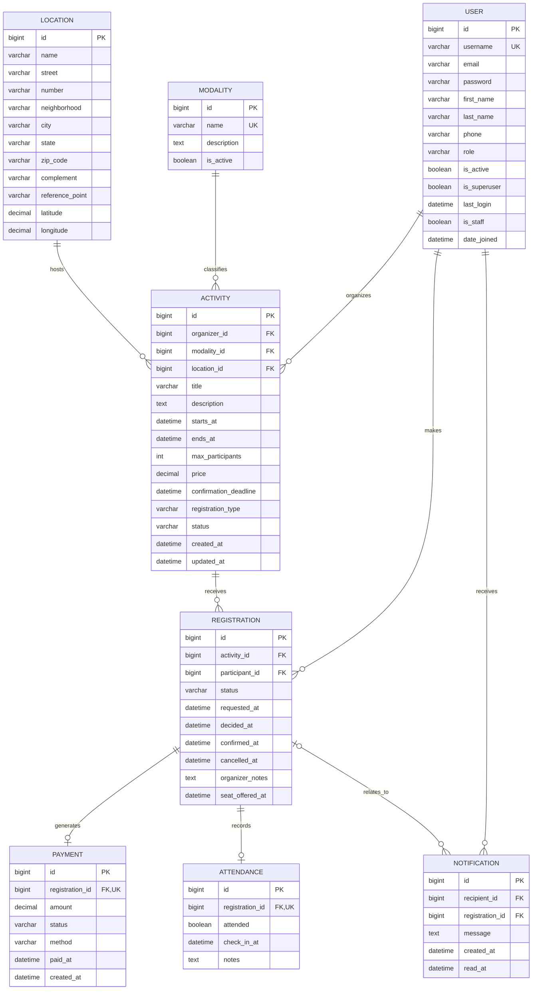

# Diagrama Entidade-Relacionamento

Este diagrama representa a modelagem relacional do sistema de gerenciamento de atividades físicas coletivas.

O diagrama mostra as oito entidades do domínio. As tabelas internas do Django (grupos, permissões, sessões e log administrativo), incluindo os relacionamentos muitos para muitos herdados de AbstractUser, foram omitidas para facilitar a leitura. Os tipos representam os campos lógicos do ORM, persistidos em SQLite.

## Relacionamentos principais

- Um usuário pode organizar várias atividades.
- Um usuário pode possuir várias inscrições.
- Uma modalidade pode estar associada a várias atividades.
- Um local pode receber várias atividades.
- Uma atividade pode possuir várias inscrições.
- Uma inscrição pode possuir no máximo um pagamento.
- Uma inscrição pode possuir no máximo um registro de presença.

## Restrições principais

- Um participante não pode possuir mais de uma inscrição para a mesma atividade.
- O limite de participantes deve ser maior que zero.
- O valor da atividade não pode ser negativo.
- O horário de término deve ser posterior ao horário de início.
- O prazo de confirmação deve ocorrer antes do início da atividade.

## Notificações e nulabilidade

- Um usuário recebe várias notificações; cada notificação possui exatamente um destinatário.
- Uma inscrição pode estar ligada a várias notificações; a inscrição da notificação é opcional (`registration_id` aceita nulo).
- Excluir uma inscrição preserva a notificação e torna sua referência nula (`SET_NULL`). Excluir o destinatário remove suas notificações (`CASCADE`).
- `read_at` nulo indica notificação não lida; `seat_offered_at` registra quando uma vaga foi oferecida a alguém na lista de espera.
- Latitude e longitude são opcionais, assim como número, complemento e ponto de referência do local.
- Datas de decisão, confirmação e cancelamento da inscrição, data de pagamento e horário de entrada também podem ser nulas.
- `username` e nome da modalidade são únicos. O e-mail é obrigatório no formulário público de cadastro, mas não possui unicidade no model.
- `registration_id` em pagamento e presença é único por ser `OneToOneField`. A combinação `(activity_id, participant_id)` é única em inscrição.

## Exclusão e integridade referencial

- Modalidades e locais utilizados por atividades são protegidos contra exclusão (`PROTECT`).
- A exclusão do organizador remove suas atividades; a exclusão de uma atividade ou participante remove as inscrições correspondentes (`CASCADE`).
- A exclusão de uma inscrição remove seu pagamento e presença (`CASCADE`).
- As restrições de vagas, valor, datas e inscrição duplicada listadas acima são declaradas em `Meta.constraints` dos models. Regras de capacidade e transição da lista de espera também são aplicadas pelo fluxo de inscrição.

